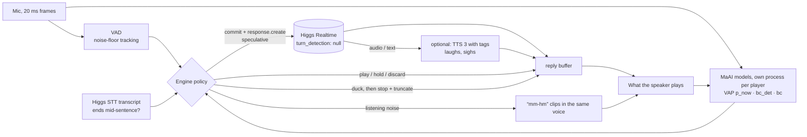

# Mm-hm: a turn-taking layer for Higgs Realtime (+ the Turing Clock)

| | plain Higgs Realtime | **Higgs + Mm-hm** |
|---|---|---|
| Talks over a 1.4 s thinking pause (unseen read sentences / real meeting speech) | 12/12 / 12/12 | **1/12 / 6/12** |
| Reply gap after a finished turn (median) | 1.1 s (`server_vad`), 0.8 s (`semantic_vad`) | **0.8 s** |
| Stops its story when you say "mm-hm" | 10/16 TTS cues, 14/40 real ones; then 1–2.5 s of silence | **3–5/16 TTS cues, 0/40 real ones live** (97% of 410 real ones pass offline) |
| Stops for a real interruption | 6/6 TTS, 20/20 real | **19/20 real live** (99% of 370 offline); volume dips at once |
| Says "mm-hm" while you talk | never | **~5/min on real speech, at 1.9× chance precision vs real listeners** |
| In babble at 15 dB SNR | 12/12 cut-ins, 1.2 s | **1–3/12, 0.76 s** |

Details and methods: `RESULTS.md`.



Higgs Realtime is fast (~530 ms from commit to first audio) and stops 125 ms after you interrupt it. But its
turn detection treats every sound as a turn: a listener's "mm-hm" stops it mid-story, and a thinking pause
gets answered as if the person were done. **Mm-hm** sits between the microphone and Higgs and makes three
decisions a human listener makes without thinking:

| Decision | How | Models |
|---|---|---|
| **Are they done, or just pausing?** | Speculative end of turn: after 100 ms of silence, if the turn-taking model says "done", commit the audio and let Higgs start generating *without playing it*. Play it once the model is confident, or throw it away if they keep talking. If Higgs's own transcript of the words so far ends mid-sentence ("…play the", "…moved to", "um,"), hold until they resume or 1.6 s pass. Hides most of Higgs's latency without answering half-sentences. | MaAI VAP (`vap_en`, 20 Hz) + `higgs-stt-3.1` input transcription |
| **Is that sound an interruption?** | Duck, then decide: the moment the user makes a sound while Higgs talks, drop Higgs's volume to 25%. Within ~400 ms: a backchannel ("mm-hm", "yeah", "right") restores the volume and is discarded; a real interruption stops playback and truncates Higgs's turn to what was heard. | MaAI backchannel detector (`bc_det_en`) + VAP |
| **When should I say "mm-hm"?** | While the user talks, play a short listening noise in the agent's own voice when the backchannel model says a listener would (p > 0.6, at most every 3 s), over the speaker as real listeners do, not only in pauses. | MaAI `vap_bc_en` + Higgs TTS 3 clips in the agent's (cloned) voice |

**Expressive voice (optional, on in the game's humanized arm):** native Realtime audio never laughs or sighs.
With `Engine(expressive=True)`, Higgs Realtime writes the reply in text mode with Higgs TTS 3 inline tags
(`<|sfx:laughter|>Haha`, `<|sfx:sigh|>Uh`, `<|emotion:surprise|>`…) and TTS 3 streams it sentence by sentence in
the same voice (`mmhm/expressive.py`). Cost: ~0.1 s more latency (first TTS audio ~0.6 s after the text
starts). On an interruption the stored reply is cut to the sentences actually heard. Tag use is up to the model
and varies run to run (5/6 replies tagged in one probe, 0/6 in another). Rendering: an AudioSet classifier (AST)
hears a sigh in 8/10 lines tagged `<|sfx:sigh|>` vs 2/10 untagged (`eval/laugh_check.py`); for laughter it is
inconclusive, because the same classifier scores Boson's own laughter demo at ~0 too. Listen before relying on it.

**Noisy rooms:** the voice-activity detector uses a minimum-statistics noise floor, and the turn-taking models
see the user's channel muted between words, so babble doesn't make the agent think you're still talking
(babble at 15 dB SNR: 760 ms replies, 1–3/12 cut-ins).

Higgs runs with `turn_detection: null`; the engine commits turns, cancels speculative responses, and sends
`conversation.item.truncate` so Higgs's memory matches what the user actually heard. The same engine can run
plain Higgs (`server_vad` / `semantic_vad`, stopping playback on `speech_started` as the docs prescribe), so
every comparison below uses the same harness.

## The Turing Clock (Human or Higgs?)

`app/` is a browser game on top of the engine. You talk to "Maya", a student at the hackathon. The clock runs;
hit **That's an AI** the moment something gives it away, and say what did. Each round is blind-assigned to
plain Higgs or Higgs + Mm-hm; the reveal shows the median time-to-catch for both.

- The one rule is "don't ask whether she's an AI". In the humanized arm, if a player asks anyway, the engine
  re-plans the reply from Higgs's transcript before it plays: "Wait, you broke the rule! No asking that, remember?"
- `/?lab` shows the internals: who is talking, p(user holds the floor), p(backchannel), and every decision.
- `/?party` is the original imitation game: a coin flip connects you either to Higgs or to a human volunteer
  on `/static/operator.html` (audio relayed through the server, same phone-line filter on both). At the end
  you guess "a person" or "an AI".
- `/dashboard` is the big-screen view for the room: rounds played, median time-to-catch per version (every
  round as a dot), how often people judge Higgs and real people to be human, and which tells gave it away.
- Results go to `out/game/rounds.jsonl` (or `$GAME_DATA`); `/api/stats` and `/api/rounds` serve them. Rounds with a forced `?mode=` are
  excluded from the stats (they're for demos).

Maya's voice is "The Soft Canadian Companion" from the hackathon voice library, registered with the Voices API
(`voices/voices.json`; `MAYA_VOICE=chloe` uses a preset instead; on another API key run `register_voices.py`). Her listening noises are TTS 3 clips
in the same cloned voice.

## Use it in your own agent

```bash
pip install -e .[mic] && pip install --no-deps maai==0.2.25
python examples/minimal_agent.py               # your mic and speakers (headphones), or --wav file.wav
```

`Engine(mode="mmhm", ...)` takes 20 ms of mic audio per `await engine.tick(mic)` and returns 20 ms for the
speaker; everything else (Higgs session, turns, truncation) is inside. `Engine.on_transcript = hook` lets an app look at Higgs's transcript of the user's turn
(~0.3 s after the speculative commit, before playback) and return a stage direction to re-plan the reply (Osmosis
uses it to recover when a learner says "sorry, what?"). `Engine.stage_direction` steers the next
reply without losing the conversation (see `../GIFT_FINDINGS.md` on why `session.update` and per-response
instructions don't).

## Run it

```bash
uv venv -p 3.12 && uv pip install -r requirements.txt && uv pip install --no-deps maai==0.2.25   # tested in a fresh venv; CPU is enough (the three MaAI models use ~21 ms per 20 ms tick across 3 threads)
export BOSON_API_KEY=...                          # or put it in a .env file
python app/server.py --port 8000                  # open http://localhost:8000 (use headphones)
```

MaAI imports `pyaudio`/`pygame` for device I/O we never use; `stubs/` provides empty stand-ins, so no
PortAudio is needed.

## Evaluations

Live against the Higgs API, with simulated users (Higgs TTS 3 voices) or real speech (AMI meeting recordings):

```bash
python eval/stimuli.py                                  # synthesize the user speech (cached)
python eval/turns.py --pause 1.4 --test                 # response gap + cut-ins, held-out stimuli
python eval/turns.py --ami 2                            # the same on real thinking pauses (eval/ami_stimuli.py --set2)
python eval/turns.py --test --pause 1.4 --noise_snr 15  # in multi-talker babble
python eval/bargein.py --conds server_vad mmhm --test   # backchannels vs interruptions, held-out cues
python eval/listen_demo.py                              # listening noises during a 30 s story
python eval/clips.py ...                                # cut listenable A/B examples from the sessions
```

Offline on real conversation (no API calls; AMI headsets, CC BY 4.0; set `AMI_DIR` to your copy of the corpus):

```bash
python eval/bargein_ami.py                              # the barge-in rule on 410 real backchannels / 370 interruptions
python eval/listen_ami.py train|test                    # listening-noise timing vs real listeners
python eval/turnend_features.py --split train|test && python eval/turnend_train.py   # learned turn-end classifier
python eval/vap_variants.py                             # which MaAI turn-taking model separates real pauses best
```

Tests: `python -m pytest tests/unit` (pure logic), `tests/browser_smoke.py` (headless Chromium + fake mic),
`tests/party_smoke.py` (two browsers), `tests/multi_player.py` and `tests/capacity.py` (many players),
`tests/record_demo.py` (screen + audio recordings for the video).

RESULTS: see `RESULTS.md`.

## Capacity

Each player's turn-taking models run in their own process (`ProcSignals`): with all players' model threads in one
process they contend for Python's GIL, and with just 2 players the models fell 6.6 s behind live audio (8 players:
15 s). With a process per player, 32 simultaneous players on a 64-core machine kept up in real time
(`tests/capacity.py --proc`), and 8 simultaneous browser players each got replies 0.64–0.76 s after their turn
ended (`tests/multi_player.py`). Rule of thumb: about one CPU core per player. The page only starts streaming
the mic once the server says "ready" (models and Higgs session up).

## Honest notes

- Most live tests use TTS voices; real meeting recordings (AMI) back the turn-taking, barge-in and
  listening-noise numbers. None of this is human judgement yet; the Turing Clock (Friday night) is for that.
- Thresholds were tuned on one stimulus set and reported on a separate held-out set (different sentences,
  cues and voices). The held-out numbers are the ones in RESULTS.md.
- Real interruptions stop ~100 ms later than plain Higgs (≈410 ms vs ≈300 ms), but the volume ducks
  immediately, so the agent audibly yields at once.
- Echo: in the browser, use headphones. Echo cancellation in Chrome does not reliably cancel Web Audio output.
- Opening several Realtime sessions at once with a preset `voice` can trip a 429 on voice validation;
  `mmhm/higgs.py` serializes session opens and backs off.
